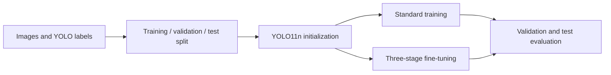

# Crop Disease Detection

**A computer-vision project combining YOLO training experiments with a crop disease web application.**

[Training source](../source/yolo-disease-training/) · [Experiment guide](../source/yolo-disease-training/README.md) · [Portfolio](../README.md)

## Project purpose

The project explores a workflow from labeled crop images to model inference and inspection of detection records. The local materials include training experiments, a Flask inference component, Spring Boot business endpoints, and a Vue interface.

The published source currently covers the training experiment. The wider application is described here from the local project structure.

## Two parts of the project

| Part | Components | Public availability |
| --- | --- | --- |
| Training experiment | Dataset splitting, label counting, standard training, staged fine-tuning, and evaluation calls | Python scripts and configuration example |
| Web application | Vue pages, Spring Boot controllers, Flask prediction code, and image/video record handling | Case study only |

## Application organization

The local web project separates the user interface, business functionality, and model inference. Controllers include prediction, image records, video records, users, and disease information. The inference component contains an image prediction module and a Flask entry point.

This separation provides a basis for studying how an ML model fits into an application with persistent records and user-facing workflows. An end-to-end deployment of the complete stack has not yet been verified for this portfolio.

## Training workflow

The published split utility uses a fixed random seed and a 70/20/10 ratio. Training defaults to a YOLO11n checkpoint, 640-pixel input size, and 100 epochs.

The staged workflow allocates 30%, 40%, and the remaining 30% of epochs to successive stages, progressively reducing the configured layer-freezing count and initial learning rate. These are experiment settings in the script. Their benefit requires comparison against a standard-training baseline.

## Labels and evaluation

The public configuration example contains three labels, BrownSpot, RiceBlast, and BacterialBlight. Some inherited filenames and experiment names contain “corn,” so the dataset configuration and annotation IDs must be checked before selecting a crop-specific interpretation.

The script reports precision, recall, mAP at IoU 0.5, and mAP averaged from IoU 0.5 to 0.95. A complete rerun with published dataset provenance and numerical results is pending.

## Reproducibility notes

The source guide documents dataset layout, command-line arguments, and the current checkpoint-path issue in the training script. Dataset images and trained weights are not included.

## Next experiments

- Establish a verified baseline on a documented, fixed data split.
- Compare the staged schedule with standard fine-tuning using the same evaluation protocol.
- Inspect confusion between disease classes and errors under different capture conditions.
- Measure inference latency before connecting a validated model to the web application.
