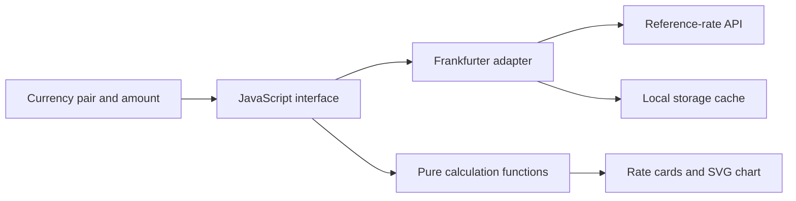

# FX Desktop Widget

**A compact Windows utility for comparing currency reference rates with their historical range.**

[Browse source](../source/fx-desktop-widget/) · [Installation guide](../source/fx-desktop-widget/README.md) · [Technical design](../source/fx-desktop-widget/docs/design.md) · [Portfolio](../README.md)

## The problem

A currency quote gives a price for today, but it provides little context about the amount someone could receive compared with previous dates. This widget places the latest available reference rate beside the lowest and highest observations in a selected historical window.

The default pair is EUR/CNY. The user chooses a base currency, a quote currency, a lookback period, and an amount to exchange.

## Features

| Capability | Behavior |
| --- | --- |
| Currency selection | Select or swap currency pairs using the provider's currency list. |
| Historical context | Display the low and high rates with their dates, plus a small trend chart. |
| Amount comparison | Calculate the base currency received today and compare it with the historical extremes. |
| Saved preferences | Retain the selected currencies, lookback period, and amount in browser storage. |
| Cached requests | Reuse recent quotes and history to reduce repeat network calls. |
| Desktop presentation | Run in an always-on-top Electron window, with minimize and close controls. |
| Windows alternative | Use the included PowerShell/WinForms implementation and desktop shortcut scripts. |

## How the web and Electron implementation works



The calculation module is independent of the page and the Electron wrapper. The interface uses a request counter to prevent an older response from overwriting a newer currency selection. The amount field can update the comparison from the data already in memory.

## A concrete calculation

For EUR/CNY, the quote is the number of CNY required for one EUR. With a hypothetical budget of 10,000 CNY and a rate of 8 CNY per EUR, the user receives 1,250 EUR.

The test fixture compares this with historical rates of 7.5 and 8.5. The differences, expressed at the current rate, are 666.67 CNY and 588.24 CNY respectively. These are arithmetic comparisons using illustrative inputs.

## Try it

Clone the portfolio repository and open the widget directory.

```sh
git clone https://github.com/Frey-Lee-6/Frey-Lee-6.git
cd Frey-Lee-6/source/fx-desktop-widget
npm install
npm start
```

For a browser preview, run `npm run serve` and open `http://127.0.0.1:4173`. The source README also explains the Windows PowerShell launcher.

## Verification and current scope

The existing Node test suite passes for date formatting, input clamping, history normalization, historical extremes, and exchange-amount calculations. It does not exercise the external API or the desktop installation process.

The application uses the provider's latest available reference data. The interface refresh interval does not determine how frequently the underlying reference rates change. The current web interface contains Chinese labels, while the PowerShell implementation includes a language toggle.

## Next improvements

- Add automated checks for network failures and concurrent requests.
- Make the web interface language configurable.
- Test installation and removal on a clean Windows environment.
