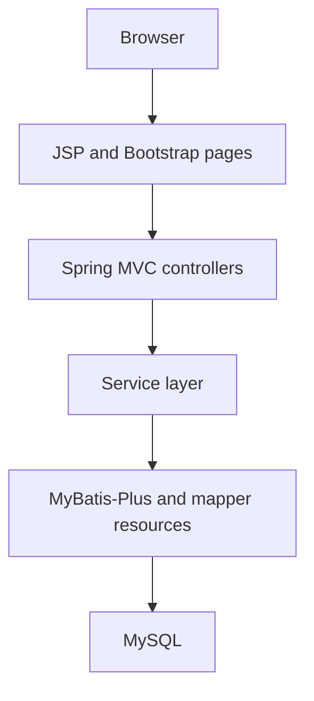

# Pet Adoption Management System

**A JavaEE course application for managing pet information and adoption requests.**

[Portfolio](../README.md) · [More coursework](coursework.md)

## Project context

This project adapts an existing Java web application for a course-based pet adoption management scenario. It brings together public pet information, user accounts, adoption applications, and administrative review.

The local project documentation identifies it as a secondary-development project. This case study describes the application visible in the reviewed code. A change-by-change account of the original work and later adaptations is still being prepared.

## Main workflows

| Area | Functionality visible in the local code |
| --- | --- |
| Pet management | List pets by type, view details, and add, edit, or remove records, including image upload handling. |
| User accounts | Register and sign in, manage profile information, and update profile images. |
| Adoption applications | Create applications, retrieve their details, filter by state, and update or delete records. |
| Adoption review | Review requests and record approval or rejection. |
| Community content | Manage comments, replies, and blog content. |
| Administration | Separate administrative pages for users, pets, applications, and content. |

A typical workflow starts with browsing pet information, continues with an adoption request, and ends with an administrative decision. User-facing pages and administrative pages share the underlying application and database.

## Technical structure

The reviewed source includes controllers for users, pets, applications, adoption decisions, comments, replies, blogs, and administrators. This organization makes the business areas visible in the codebase.

## Technology stack

| Layer | Technology |
| --- | --- |
| Web application | Java, Spring MVC |
| Persistence | MyBatis-Plus, MySQL, Druid |
| Views | JSP, JSTL, Bootstrap |
| Build and deployment | Maven, WAR packaging, Tomcat |

## Engineering topics illustrated

The project provides material for studying form handling, relational CRUD operations, pagination, session-based login, multipart uploads, and status-driven administrative workflows.

## Available materials

Several local source versions and supporting project materials have been located. This public page is the current case study. The application source, database setup, and a verified deployment package have not yet been published here.

## Planned improvements

- Document the application states and allowed transitions.
- Add explicit authorization tests for administrative actions.
- Prepare a synthetic demonstration database and configuration example.
- Record a reproducible deployment procedure and a feature walkthrough.
